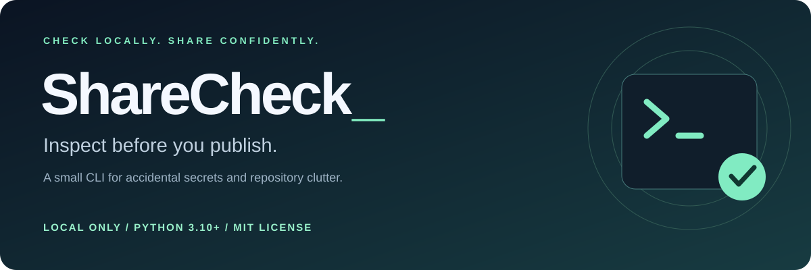
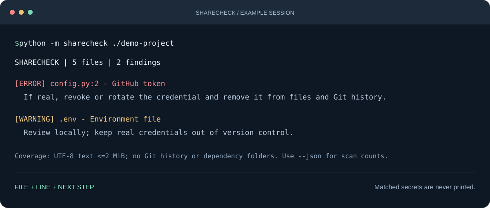

<p align="center"><strong>English</strong> · <a href="README.ru.md">Русский</a></p>

<p align="center">
  
</p>

<p align="center">
  <strong>Scan your folder. Review your findings. Share with confidence.</strong><br>
  A local CLI for spotting accidental secrets and preparing your project for GitHub.
</p>

<p align="center">
  <a href="#quick-start">Quick start</a> ·
  <a href="#commands">Commands</a> ·
  <a href="#what-it-checks">Features</a> ·
  <a href="#limitations">Limitations</a>
</p>

---

**No account. No uploads. No third-party runtime dependencies.**

ShareCheck scans files on your computer and prints findings directly in your terminal: a path, line number, and suggested next step. Matched tokens and source lines are never printed. Your source files are not modified.



*Illustrative output from a sample project. Colors are part of the documentation artwork; the CLI itself prints plain text.*

## Quick start

Requires **Python 3.10 or newer**. Works on Windows, macOS, and Linux.

### 1. Download the project

On the repository page, select **Code → Download ZIP**, extract the archive, and open a terminal in the folder containing `pyproject.toml` and this README.

### 2. Check Python

```sh
python --version
```

On macOS and Linux, the command may be `python3`. If so, use it instead of `python` throughout these examples.

### 3. Run a scan

```sh
python -m sharecheck .
```

The dot means the current directory. To scan another project, provide its path:

```powershell
# Windows / PowerShell
python -m sharecheck "C:\Users\you\Projects\my-app"
```

```sh
# macOS / Linux
python3 -m sharecheck ~/Projects/my-app
```

Without installation, run these commands from the ShareCheck folder. To run from anywhere, install the command below.

### Install the `sharecheck` command

From the project folder:

```sh
python -m pip install .
sharecheck --help
sharecheck .
```

Installation may download build tools. The scanner itself makes no network requests. If `sharecheck` is not found, use `python -m sharecheck` with the same Python interpreter you installed the package into.

<details>
<summary><strong>Install in a virtual environment</strong></summary>

Windows / PowerShell:

```powershell
python -m venv .venv
.\.venv\Scripts\python.exe -m pip install .
.\.venv\Scripts\sharecheck.exe .
```

macOS / Linux:

```sh
python3 -m venv .venv
.venv/bin/python -m pip install .
.venv/bin/sharecheck .
```

These commands do not require activating the environment.

</details>

## Commands

| Task | Command |
| :--- | :--- |
| Scan the current directory | `python -m sharecheck .` |
| Scan another project | `python -m sharecheck "path/to/project"` |
| Print JSON | `python -m sharecheck . --json` |
| Save an HTML report | `python -m sharecheck . --html report.html` |
| Show help | `python -m sharecheck --help` |

Quote paths containing spaces. If you omit the folder argument, ShareCheck scans the current directory. Without installation, run commands from the ShareCheck folder.

### HTML reports

```sh
python -m sharecheck "path/to/project" --html report.html
```

Open `report.html` in your browser to see findings, recommendations, and skipped-file counts. The report is standalone and needs no server. The output path is relative to your current directory. Existing files are never overwritten; choose a new filename instead.

### JSON for scripts

```sh
python -m sharecheck "path/to/project" --json
```

The result contains `root` (the project path), `stats` (scan counts), and `findings`. Each finding contains `severity`, `path`, `line`, `title`, and `advice`. The `line` field can be `null`.

## What it checks

| Check | Result |
| :--- | :--- |
| Selected GitHub and Slack token formats | `ERROR`: file, line, and advice |
| AWS access key IDs | `ERROR`: a matching key identifier |
| Private key headers | `ERROR`: a possible private key |
| `.env` and `.env.*` files | `WARNING`: review the environment file |
| Credential filenames and `.p12` / `.pfx` containers | `WARNING`: a potentially sensitive file |
| Files larger than 50 MiB | `WARNING`: consider Git LFS or a separate download |
| Missing README, license, or `.gitignore` | `INFO`: repository readiness advice |

Environment files ending in `.example`, `.sample`, or `.template` are exempt from the filename warning. Their contents are still checked for supported secret patterns.

### Understanding findings

- **ERROR** — a secret pattern matched. Check locally whether the credential is real. If exposed, revoke or rotate it; deleting it from a file does not remove it from Git history.
- **WARNING** — a file needs review. For example, an `.env` file might contain harmless settings, but it is worth checking.
- **INFO** — a repository readiness suggestion, not an error.

### Exit codes

| Code | Meaning |
| :---: | :--- |
| `0` | No `ERROR` or `WARNING` findings in inspected files; `INFO` findings are allowed |
| `1` | At least one `ERROR` or `WARNING` finding |
| `2` | The command failed, for example because the folder does not exist or the report cannot be written |

Exit code `1` means findings were detected, not that the application crashed. These codes make ShareCheck usable in automated checks.

## Limitations

ShareCheck is a small pre-publication check, not a complete security audit.

- Content scanning covers **UTF-8 files up to 2 MiB**. Binary files, larger files, and other encodings are skipped; counts appear in the report.
- `.git`, `node_modules`, `.venv`, `venv`, `__pycache__`, and `.pytest_cache` directories are excluded. Symbolic links are not followed.
- Working files are scanned, including files listed in `.gitignore`. Git history, archives, and arbitrary passwords are not inspected.
- Example tokens can also trigger findings. Credentials are not validated against external services.
- Reports omit matched secret values but include file paths and the absolute project path. Consider this before sharing a report.

No findings does not guarantee that a project contains no secrets. Use a dedicated secret scanner for deeper checks. Scan trusted local folders that are not being modified during the scan.

## Development

Run tests from the project root:

```sh
python -m unittest discover -s tests -v
```

```text
sharecheck/
├── sharecheck/
│   ├── __main__.py       # Commands and exit codes
│   ├── scanner.py        # File checks
│   └── report.py         # HTML reports
├── tests/               # Tests with synthetic data
├── docs/images/         # README artwork
└── pyproject.toml       # Package metadata and installation
```

Contribution ideas include precise detection patterns with synthetic fixtures, localization, and staged-file scanning. These additions are not implemented yet. Never add real secrets to tests or reports.

## License

[MIT](LICENSE) — use, modify, and distribute under the license terms.

---

<p align="center">If ShareCheck helped you prepare a project for publication, consider giving it a star ⭐</p>
